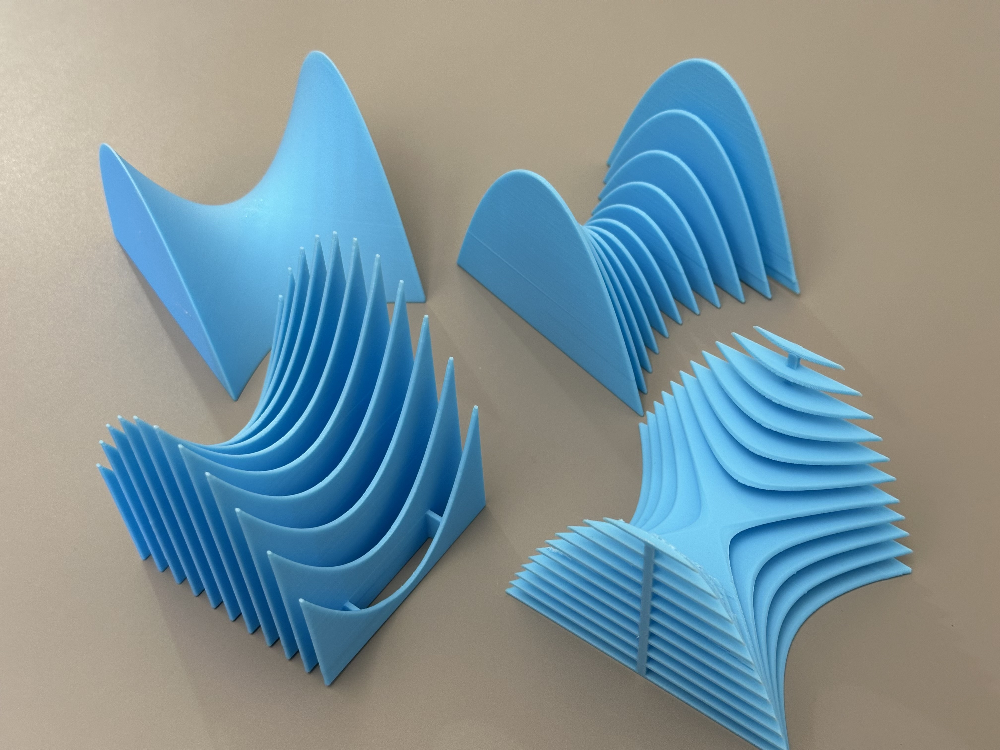
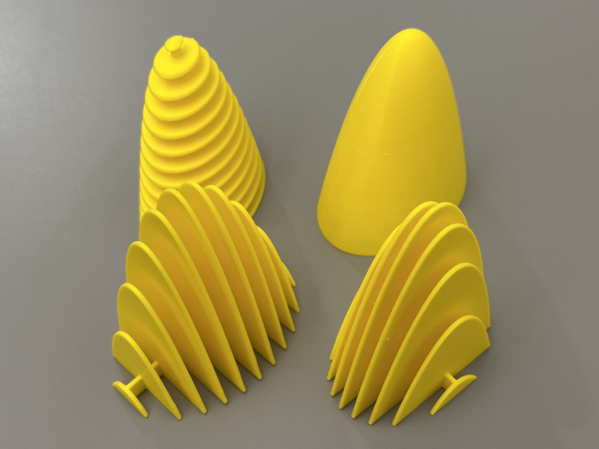
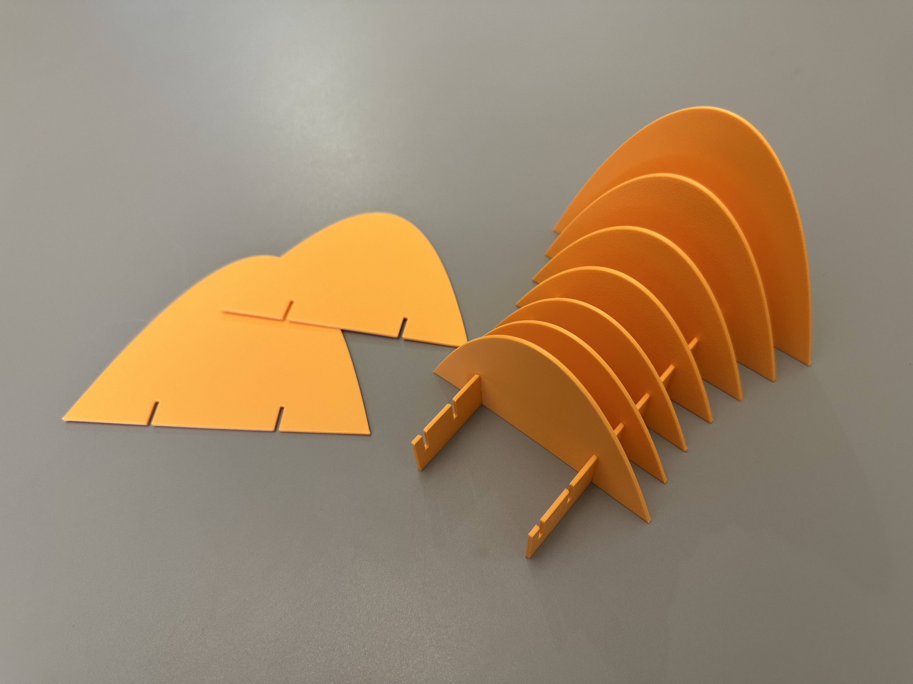

# MV-Calc Slices (OpenSCAD)

This OpenSCAD code generates **3D-printable multivariable calculus surfaces** in a variety of formats. You define a function `f(x,y)` over a rectangular domain, and the script can produce:

- The full 3D surface as a watertight solid (`MODE="solid"`)
- A single slice in which **x = constant** (`MODE="slice_x"`), with a slot to fit onto a matching stand (`MODE="stand_x"`)
- A single slice in which **y = constant** (`MODE="slice_y"`), with a slot to fit onto a matching stand (`MODE="stand_y"`)
- A one-piece assembled model: stand(s) plus **all** `slice_x` slices (`MODE="all_slices_x"`)
- A one-piece assembled model: stand(s) plus **all** `slice_y` slices (`MODE="all_slices_y"`)
- The full solid cut into horizontal slabs (`MODE="all_slices_z"`)

Everything is parameterized in the top section of [Slices.scad](Slices.scad), including the function, domain, scaling, number of slices, and stand locations.

## Gallery

Below are examples of 3D models produced with this repository. 



*Hyperbolic paraboloid* 



*Elliptic paraboloid* 



*Assembled slices and stand*


## Preset surfaces

The code contains a few predefined surfaces defined in separate `.scad` files, all included by [Slices.scad](Slices.scad).

- [hyperbolic_paraboloid.scad](hyperbolic_paraboloid.scad)
- [hyperbolic_paraboloid_for_lab.scad](hyperbolic_paraboloid_for_lab.scad)
- [elliptic_paraboloid.scad](elliptic_paraboloid.scad)
- [elliptic_paraboloid_for_lab.scad](elliptic_paraboloid_for_lab.scad)
- [sombrero.scad](sombrero.scad)

Choose one with the `SURFACE` dropdown (in the Customizer, or near the top of [Slices.scad](Slices.scad)). Choose `custom` to use your own function and parameters (`f_user`, `xmin`, `ymin`, `x_span`, `y_span`, and the column settings) in [Slices.scad](Slices.scad).

Each preset file named `<name>.scad` provides two functions:

```scad
function <name>_f(x,y) = ...;
// [xmin, ymin, x_span, y_span, column_size_x, column_size_y, column_centers]
function <name>_params() = [ ... ];
```

To add a preset, create a new file with those two functions, `include` it in [Slices.scad](Slices.scad), add its name to the `SURFACE` dropdown, and add it to the `f` and `params` selectors.

`<name>_f` returns the mathematical height over the domain. Preset functions in
this repository include coefficients that preserve their previous default
models under uniform XYZ scaling.

## Modes

Set `MODE` to one of the following:

- `"solid"`: full 3D surface solid over the domain
- `"slice_x"`: a single slice with **x = constant** (y varies along the slice)
- `"slice_y"`: a single slice with **y = constant** (x varies along the slice)
- `"stand_x"`: stand that mates with `slice_x`
- `"stand_y"`: stand that mates with `slice_y`
- `"all_slices_x"`: one-piece assembled model: stand(s) + **all** `slice_x` slices (no slots)
- `"all_slices_y"`: one-piece assembled model: stand(s) + **all** `slice_y` slices (no slots)
- "all_slices_z": full solid cut into horizontal slabs by deleting thin horizontal boxes (slab count is computed automatically)

For `MODE="all_slices_z"`, the bottom slab sits on the XY plane (`z=0`). Each slab has thickness `slice_thickness`, the vertical pitch rule is based on the X-direction slice spacing (approximately `x_length/(numslices-1)` mm), and the number of slabs is computed automatically from the sampled maximum height of the surface.

If you see a tiny “top remnant” slab, you can nudge the pitch via:

- `slab_pitch_mult` (default `1.0`; try `1.03`, `0.97`, and so on)

`MODE="all_slices_z"` also supports vertical columns as built-in support. In [Slices.scad](Slices.scad), set:

- `column_size_x`, `column_size_y` (mm)
- `column_centers = [[x0,y0], [x1,y1], ...]`

Column centers are relative to the object's size, so they follow `x_length`: `[0,0]` is the center, and `-1` or `1` puts a column flush against the corresponding edge (e.g. `[[-1,0],[1,0]]` places columns at the left and right edges).

The columns are generated as solids above each rectangular base footprint, under the surface, and capped at the top of the highest remaining horizontal slice (so their tops may be curved, and they will not extend into the deleted gap regions).

When using a preset surface, the column settings come from that preset file’s `<name>_params()` (the last 3 entries).

## Defining the function

If using custom mode (`SURFACE = "custom"`), edit the custom function near the top:

```scad
function f_user(x,y) = 0.75*(x*x - y*y);
```

Notes:

- `x` and `y` are *mathematical* coordinates over your chosen domain.
- OpenSCAD’s `sin/cos/tan` expect **degrees**. This file includes helpers `sin_rad`, `cos_rad`, `tan_rad` for radians.

## Domain, scaling, and physical size

The domain is mapped uniformly into the physical object:

- **Domain** (math units)
  - `xmin`, `ymin`
  - `x_span`, `y_span`
- **Physical size** (mm)
  - `x_length`, `y_length`

`y_length` is derived from the domain aspect ratio. One mathematical unit in
the X, Y, and Z directions is scaled by `x_length / x_span` millimeters.
Consequently, the mathematical function is not independently stretched or
translated vertically; its units and values determine the shape and height.
To change its height or vertical position, edit the function itself.

When using a preset surface, its domain and support-column parameters
come from that file’s `<name>_params()`; the function comes from `<name>_f`.

The solid/slices then use the clipped height:

- `z_solid_mm(x,y) = max(0, (x_length / x_span) * f(x,y))`

The generated 3D solid only includes the portion of this surface **above the XY plane** (`z>=0`). If the surface dips below `z=0`, those regions contribute no volume.

Slice profiles (used by `MODE="slice_*"` and also by the assembled modes) use the same height map:

- `z_slice_mm(x,y) = z_solid_mm(x,y)`

If your surface is clipped by the XY plane, change the function so more of it
lies above zero. Changing `x_length` scales X, Y, and Z together.

## Generating a full surface solid

1. Set:
   - `MODE = "solid";`
2. Optionally increase smoothness (slower renders):
   - `solid_nx`, `solid_ny`

## Generating slices (and stands)

### Slice family controls

- `numslices`: how many slices exist in the family
- `k`: which slice index to generate (`1 ... numslices`)

Slices are **evenly spaced** across the chosen domain:

- `slice_x`: holds \(x\) constant and varies \(y\)
- `slice_y`: holds \(y\) constant and varies \(x\)

## Generating a one-piece assembled model (stand + all slices)

If you want the “complete classroom object” as one STL (no assembly, no slots):

1. Set:
   - `MODE = "all_slices_x";` (or `"all_slices_y"`)
2. Set `numslices`.
3. Set `stand_locations` to control where the stand(s) sit along the slice length.
   - Example: `stand_locations = [0.5];` places the stand halfway along every slice.
   - Example: `stand_locations = [0.25, 0.75];` places two stands.

For the horizontal-slab variant use `MODE = "all_slices_z"`:

1. Set:
   - `MODE = "all_slices_z";`
2. Set `numslices` (controls the vertical pitch via approximately `x_length/(numslices-1)` mm).
3. Adjust slab parameters:
   - `slice_thickness` (mm) controls individual slab thickness.
   - `slab_pitch_mult` (multiplier for vertical pitch; default `1.0`) nudges the vertical spacing — if you see a tiny top remnant slab, try values slightly above or below `1.0` (e.g. `1.01` or `0.97`).
4. Optional vertical columns/supports:
   - Set `column_size_x`, `column_size_y` (mm) and `column_centers = [[x0,y0], ...]` (relative positions; see above) to add rectangular columns under the surface. Columns are capped at the top of the highest remaining slab and will not extend into deleted gap regions.
5. Note: the bottom slab sits on the XY plane (`z=0`). 

Note: Printing the z=constant models can be a challenge. One option is to rotate the model 90° so that the horizontal slices are vertical. Still, many shapes require quite a bit of printing support.